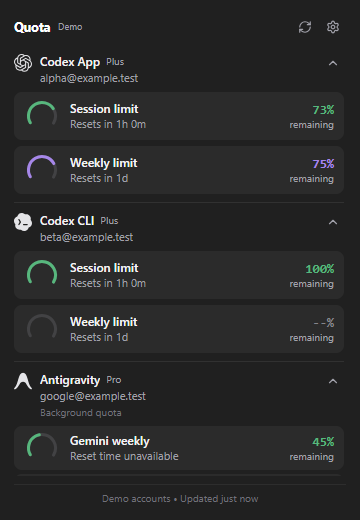

# Quota

A minimal Windows tray monitor for two independent Codex accounts, one Antigravity account, optional Claude profiles and GitHub Copilot. Quota reuses the MIT-licensed [costats](https://github.com/fmdz387/costats) account engine with its own native host, name and React interface. Current release: **1.0.0**.



## Run the portable app

[Download the latest Windows x64 release](https://github.com/Tonmailnwza007/Quota/releases/latest).

Quit an older Quota build from its tray menu before starting this version. Extract the entire ZIP and run `quota.exe`. Keep the adjacent `renderer` folder, scripts and bundled files together. The app starts hidden in the Windows notification area; check hidden tray icons if necessary. The portable app includes its .NET runtime. Microsoft Edge WebView2 Runtime must already be installed; no Node, Rust, .NET SDK or installer is needed.

The download contains no saved accounts, credentials, settings, usage history or browser profile. Quota reads existing sign-ins on the computer where you run it. Release binaries omit debug symbols and map source paths to a generic build directory.

- Click the tray icon to toggle the compact flyout near that icon. There is no dashboard, taskbar button, resize switch, title bar or maximize control.
- Click outside or press Escape to dismiss it. Escape closes settings first.
- `Ctrl+Alt+U` toggles it when that shortcut is available. Another running app may own the shortcut.
- Use **Quit** in the tray menu to exit.
- Enable **Settings > Start with Windows** to start hidden in the tray when you sign in. This is off by default and applies to your Windows account without administrator access. Keep this portable folder in place; if you move or upgrade to a new folder, enable the switch from that copy. Turn it off before deleting Quota. Windows may delay startup or disable it through Task Manager.
- Clicking the tray icon while Quota initializes opens the panel once it is ready, without a loading warning. Missing files or WebView2 failures still produce an actionable error.
- Settings has five saved provider switches. New installations enable **Codex App**, **Codex CLI**, and **Antigravity**; Claude and Copilot are optional. Valid existing preferences carry forward. Changes filter immediately and save automatically.
- Each account header's arrow folds its entire quota section. Accounts expand independently, stay folded through refreshes and hiding/reopening the flyout, and reset to their default after restarting Quota. Detected providers start expanded; unavailable providers start collapsed. Without a manual override, a newly detected provider opens automatically.
- Token and estimated API-cost details are hidden by default. Enable **Advanced settings → Show usage details** to reveal a separate details control inside expanded accounts.
- **Low-quota notifications** use percent **remaining**. Both thresholds are editable whole percentages: defaults **10% warning / 5% critical**, with `0 ≤ critical < warning ≤ 100`. Save both together with **Save alerts**; the notification switch saves immediately. **Test notification** requests a Windows tray notification. Windows notification/Do not disturb preferences control banner delivery.
- Advanced source paths, Antigravity account source and the refresh interval apply together with **Save source settings**. Blank Codex paths use automatic selection. Custom Antigravity mode requires an auth JSON file or credential target.

Version 0.1.1 replaced the Electron top-level window with a native Windows popup/tool window containing WebView2. This matters for window managers that explicitly tile `Chrome_WidgetWin_1` windows: the new top-level window has a `WindowsForms...` class, `WS_POPUP` and `WS_EX_TOOLWINDOW`, with no caption, sizing frame or app-window style. Chromium is an embedded child. No window-manager configuration is changed.

Preferences remain at `%LOCALAPPDATA%\quota\settings.json`; existing valid Quota preferences are retained. The WebView2 profile lives at `%LOCALAPPDATA%\quota\webview`. Original WPF settings, executables and startup registration are not modified. Antigravity's existing saved session may be renewed without changing the client's account.

## Readings and account selection

**Codex App** defaults to `~/.codex/auth.json`, independently of `CODEX_HOME`. **Codex CLI** uses an explicit source first, otherwise a distinct `CODEX_HOME`, otherwise one uniquely identifiable different saved Zeron account. Ambiguous saved accounts require an explicit selection. Invalid configured sources report unavailable data instead of silently substituting another account. Local token/cost totals are scoped to the selected account's attributed sessions.

The two Codex cards identify their own account and quotas. Shared Codex accounts are marked rather than counted as separate allowances. Readers use existing sign-ins. Codex and Claude readers remain read-only. Antigravity can renew its existing saved session; it never starts a new sign-in or switches a client's account.

**Antigravity** is one saved account covering App and CLI usage. After signing in once, neither client needs to remain open for Quota's background reader. Quota must stay running and connected to the internet. It verifies the selected Google identity, resolves account/project context and requests fresh quota directly from Google's authoritative daily service. It does not query a running client, launch either client, read an old client quota cache or send a model request. The old App account-binding file is no longer used. Provider endpoint changes may require a Quota update.

Antigravity defaults to the shared Windows credential `gemini:antigravity`. **Advanced settings > Antigravity credential source** can select a custom auth JSON file or credential target. The file takes priority when both fields are filled; a missing/invalid explicit source never falls back to the default account. Expired access tokens are renewed once using the saved refresh token and matching OAuth client. Quota verifies the Google account, preserves credential fields and checks for changed credentials before saving or publishing quota. Windows Credential Manager does not provide an atomic compare-and-swap across unrelated applications.

Revoked/missing refresh tokens or incompatible OAuth clients still require signing in again through Antigravity or its CLI. Permission errors (403), service outages and unavailable measurements are shown separately. Failed refreshes clear quota values instead of presenting old values as current. Credential/account/source changes invalidate in-flight responses. Model names and resets come from the source; unknown quota remains unknown.

Quota tiles now show **remaining** allowance, as in the Limit Lens reference: a source reporting 78% used displays 22% remaining; a confirmed 0% used displays 100% remaining. Unknown readings remain neutral `--%`. Percentages use at most one decimal place. Dollar values are estimated API-price equivalents, not subscription bills. Weekly consumption starts Monday; the longer consumption window is 30 days. Shared allowances are never added together.

Credentials stay inside the C# readers. Only explicit display DTOs and validated preferences cross the narrow WebView2 message API. The renderer has no Node or general native-object access. External links use a provider allowlist; navigation, downloads and permissions are blocked. There is no HTTP account-data server or credential export.

## Alerts and shared quotas

Quota must remain running in the tray to evaluate alerts after successful refreshes. Hidden/disabled providers do not alert. Unknown, expired, stale and log-estimated quotas do not alert. Each threshold alerts once per account/quota cycle; a jump straight below critical produces one critical alert. Matching shared App/CLI quota buckets are deduplicated, and simultaneous notices are grouped. Notification history beside settings (`notification-history.json`) stores hashed account/quota keys, bands and timestamps only, using atomic writes. Restarting does not repeat the same alert. A confirmed reset rearms alerts; sources with no reset need two fresh readings recovered more than two points above warning. The historical Electron host does not deliver these native alerts; use the default native portable release.

Antigravity has one card and no Shared/Same quota badge. Codex retains its **Shared** badge when both sources identify the same allowance. Antigravity follows its documented [unified sign-in](https://www.antigravity.google/docs/install?tab=cli); the card represents the selected saved quota account rather than an interactive client's login state.

## Upgrading from 0.1.x

Existing valid settings, Codex paths, refresh interval, optional details and alert thresholds are retained. Old Antigravity App/CLI switches merge into one: either enabled keeps Antigravity visible; both disabled keeps it hidden. Old custom CLI credentials migrate to the unified source settings. If previously enabled sources could select different accounts, Quota requests a source choice in Advanced settings before fetching. Reading/migrating settings does not modify the file; the next explicit save writes the canonical format. Unreadable/invalid preferences fail closed with providers disabled until repaired. Missing credentials invalidate the verified session without restoring a deleted grant.

## Visual identity and logos

The native flyout remains **360x520 DIPs** when accounts fold/unfold, providers change or settings open. Header/footer stay pinned and the account list scrolls in the remaining space. Folding frees room inside the panel and does not move its edges. Monitor work-area/DPI clamping is retained, including smaller screens. Both Codex accounts remain adjacent. Windows rounded corners are requested through DWM. No manual size controls are exposed.

Neutral charcoal, fine separators, compact spacing and restrained status colors follow a minimal Vercel/Linear-inspired design. Real monochrome OpenAI, Codex, Antigravity, Claude and Copilot SVGs are bundled from [Lobe Icons](https://github.com/lobehub/lobe-icons), pinned to `@lobehub/icons-static-svg` 1.95.1. Provenance and hashes are in `web/public/brands/SOURCES.json`; licenses are in `THIRD_PARTY_NOTICES.md`. Quota has its own tray/app icon. No runtime CDN is used.

## Develop and build

Use Windows x64, Node 24+ and .NET 10 SDK. WebView2 Runtime is required to run the host.

```powershell
npm.cmd --prefix web ci
npm.cmd --prefix web run lint
node --test native/tests/preload.test.cjs
dotnet test bridge/tests/Costats.Bridge.Tests.csproj -c Release

# Build React and publish the self-contained native portable folder.
npm.cmd --prefix desktop run package-native

# Hidden synthetic integration check; no real credentials or visible window.
$env:COSTATS_SMOKE_OUTPUT = "$env:TEMP/quota-native-smoke"
& ./artifacts/1.0.0/quota-win32-x64/quota.exe --smoke

# Browser-only design fixtures.
npm.cmd --prefix web run dev
```

If the SDK is task-local, set `$env:DOTNET_PATH` to its absolute `dotnet.exe` path before packaging. Native packaging uses Node's built-in modules and web dependencies; Electron dependencies are only needed for the historical alternative. Packaging refuses to overwrite an existing version folder. `--fixture` starts a synthetic tray session; `--smoke` additionally uses isolated temporary preferences/profile and exits after checks, without sending a real Windows notification banner.

## Source layout

- `web/`: React UI, settings, fixtures and display adapter.
- `native/`: default Windows Forms/WebView2 flyout host, validated message preload, native styles, tray lifecycle and hidden integration checks.
- `bridge/`: reusable C# runtime, isolated settings persistence, display mapping, standalone stdio worker and tests.
- `contracts/`: display types and both native/standalone transport descriptions.
- `engine/`: vendored tested Core/Application/Infrastructure, upstream MIT license, provenance and documented read-only Claude adaptation.
- `desktop/`: earlier Electron alternative and shared package version/build tooling. Electron launch/package commands remain historical alternatives; use `package-native` for the corrected tray release.

See `CHECKPOINT.md` for evidence and manual interaction limits. The portable build is unsigned and has no auto-updater.
